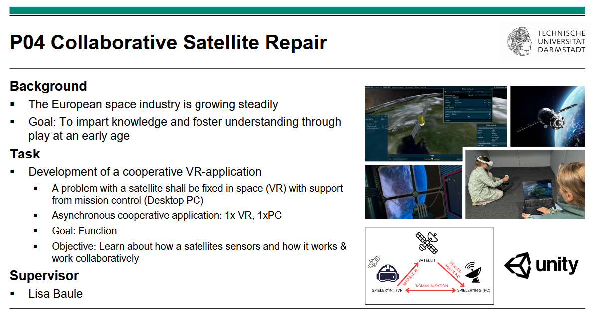

# SatteliteFixer

**P04 – Collaborative Satellite Repair**
Group project for the *Serious Games* course, winter term 2026/27, TU Darmstadt.
Supervisor: Lisa Baule



## About

The European space industry keeps growing, and SatteliteFixer is meant to give
young players a hands-on feel for it. It is a **cooperative VR serious game**:
a satellite in orbit has a fault, and two players have to work together to fix it.

- **Player 1 – Astronaut (VR):** is out in space next to the satellite and carries
  out the repair.
- **Player 2 – Mission Control (desktop PC):** watches the satellite's telemetry and
  sensor data, spots the fault and guides the astronaut through the fix.

```
                 Satellite
               /           \
     repair   /             \   fault report
             /               \
  Player 1 (VR) <-----------> Player 2 (PC)
              communication
```

The game is **asymmetric**: each player sees and can do different things, so
neither of them can finish the repair alone. Only by communicating can they work
out what is broken and how to fix it.

## Goals

- **Learning:** players find out how a satellite is built, which sensors it carries
  and how the subsystems work together.
- **Collaboration:** players practice clear communication and teamwork through
  their split roles.
- **Target group:** children and teenagers. The goal is to teach and spark interest
  through play, at an early age.
- **Project focus:** a working prototype (function first).

## Setup

| Aspect        | Details                                   |
|---------------|-------------------------------------------|
| Engine        | Unity                                     |
| Platforms     | VR headset (player 1) + Windows PC (player 2) |
| Player count  | 2 (1× VR, 1× PC), asymmetric co-op        |

## Repository structure

> The Unity project has not been created yet. Update this section once it exists.

## Team

Serious Games group project, WiSe 2026/27, TU Darmstadt.

## License

[MIT](LICENSE)
