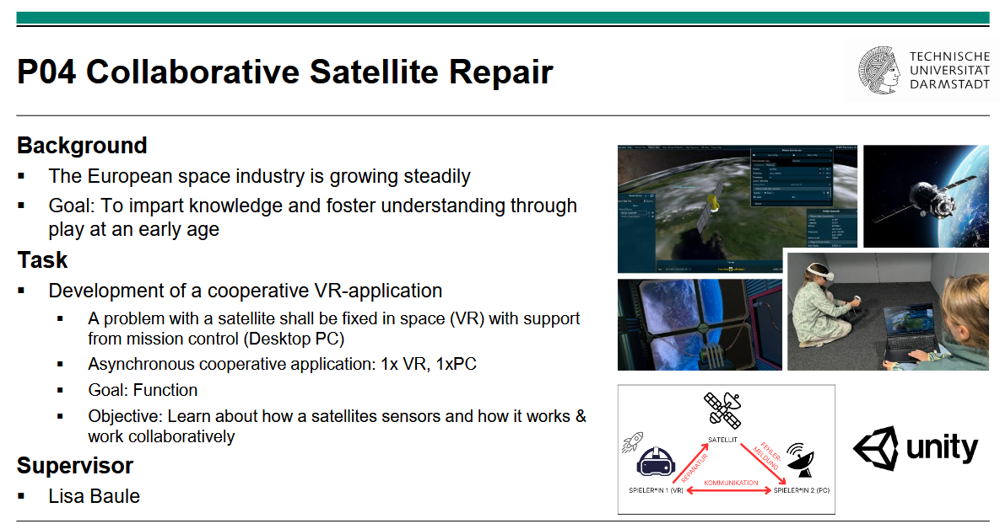

# SatteliteFixer

**P04a – Collaborative Satellite Repair**
Group project for the *Serious Games* course, winter term 2026/27, TU Darmstadt.
Reviewer: Dr.-Ing. (habil.) Stefan Göbel · Supervisor: Lisa Baule



The full concept is in [Seriouse_Games_Praktikum-3.pdf](Seriouse_Games_Praktikum-3.pdf)
(project definition, component diagram, work packages, schedule).

## About

Satellites are everywhere in daily life (weather, navigation, crisis communication),
but few people know how they are built or how they work. SatteliteFixer is a
**serious game based on asymmetric co-op** that aims to close that gap.

Two players have to bring a broken satellite back into operation:

- **Operator (PC):** works in a space control centre, for example at ESA. They
  have the mission data, sensor data and a digital handbook, spot the fault and
  guide the astronaut.
- **Astronaut (VR, Meta Quest 3):** floats in space next to the satellite, finds
  the source of the fault, does the repair and reports back what they see.

Each player has different information, so they can only solve the problem by
talking to each other. Both players are **in the same room** and talk directly,
with no in-game voice chat. The **game state is synchronized in real time**
between the PC and the VR app.

From level to level the players meet different **real ESA satellites**, each with
its own look, purpose and sensors. The 3D models come from
[ESA SciFleet](https://scifleet.esa.int/). Faults occur at random.

## Target group & learning goals

- **Where it is played:** DLR School Lab Darmstadt.
- **Players:** kids and teenagers from **grade 8** who are interested in science
  and technology. The content builds on school physics, especially the introduction
  to electricity.
- **Learning goals:**
  1. Basic knowledge of real satellite programmes and the technology they use.
  2. Focused communication and cooperative problem solving when each player has
     different information.

## Architecture

```
Physical room ───────────────────────────────────────────────────────────────
  Player A – Astronaut                          Player B – Operator
  Unity VR app (client)                         Unity PC app (host)
  ├ Interface                 verbal            ├ Interface
  ├ Environment: satellite  ◄──────────►        ├ Environment: control centre,
  │  & sensor models, skybox                    │  handbook, sensor data view
  └ Gameplay: movement in VR,                   └ Gameplay: game state management,
     interaction with sensors   ◄── network ──►    scenario management
     and the satellite          (game state)                │
                                                       local data (game state)
```

There are five technical components:

| # | Component | VR app (astronaut) | PC app (operator) |
|---|-----------|--------------------|-------------------|
| 1 | Interface | HUD and hints | Sensor data, fault states, pending tasks |
| 2 | Environment | Satellite and sensor models, skybox | Control centre, digital handbook (sensors, ESA programmes) |
| 3 | Gameplay VR | Moving around the satellite, inspecting sensors, repairing | |
| 4 | Gameplay PC | | Generating random faults, checking repairs, managing the game state |
| 5 | Network | Client | Host; the game state (e.g. successful repairs) is synced in real time |

Both apps live in **one Unity project** with two scenes and shared code for the game
state (see [Code structure](#code-structure)).

## Setup

| Aspect        | Details                                                       |
|---------------|---------------------------------------------------------------|
| Engine        | Unity 6 (6000.6.6f1), URP                                     |
| XR            | OpenXR + XR Interaction Toolkit (VR Core template)            |
| VR device     | Meta Quest 3                                                  |
| Platforms     | Quest 3 (astronaut, VR client) + Windows PC (operator, host)  |
| Player count  | 2, asymmetric co-op, same room                                |
| 3D assets     | ESA SciFleet satellite models                                 |

## Repository structure

```
SatteliteFixer/                    repo root: README, CLAUDE.md, LICENSE, concept PDFs
└── SatelliteFixer/                Unity project (open this folder in Unity Hub)
    ├── Assets/
    │   ├── _Project/              our own content
    │   │   └── Scripts/
    │   │       ├── Core/          shared game state model (satellites, sensors, faults)
    │   │       ├── Network/       game state sync (transport-independent)
    │   │       ├── Operator/      PC app: game state, scenarios, mission control UI
    │   │       └── Astronaut/     VR app: satellite spawning, repairable sensors
    │   └── …                      template content (VRTemplateAssets, Samples, XR, …)
    ├── Packages/
    └── ProjectSettings/
```

### Code structure

- **Core:** `SatelliteDefinition`, `SensorDefinition` and `FaultDefinition` are
  ScriptableObjects (create them via *Assets → Create → SatelliteFixer*). `GameState`
  is the plain, serializable state that both apps share.
- **Network:** gameplay code only talks to `GameStateSync`.
  - `LocalGameStateSync` is a loopback for testing both roles in one scene in the editor.
  - The real network transport (AP 3) will be a second implementation of `GameStateSync`.
- **Operator (host):**
  - `GameStateManager` owns the state, saves it locally and publishes every change.
  - `ScenarioManager` starts scenarios, picks random faults and checks repair attempts.
  - `OperatorStatusView` and `HandbookView` are first, minimal UIs.
- **Astronaut (client):**
  - `SatelliteSpawner` spawns the model of the current satellite.
  - `RepairableSensor` sits on a sensor of the model. It reacts to faults and sends repair actions, e.g. from an XRI interactable.

### Getting started

1. Clone the repo.
2. Install Unity **6000.6.6f1** via Unity Hub, with **Android build support**
   (Quest 3) and Windows build support.
3. In Unity Hub, choose **Add → Add project from disk** and select the `SatelliteFixer/`
   **subfolder**, not the repo root.

Unity creates `Library/`, `Temp/`, `Logs/` and `UserSettings/` on first open. They are
ignored by git.

## Team & schedule

| Work package | Lead |
|--------------|------|
| 0 Management & coordination | Max |
| 1 Interface (satellite data view, handbook) | Max |
| 2 Environment (satellite & sensor models, world graphics) | Max |
| 3 Network (host, VR connection, scenario & game state sync, error handling) | Lasse |
| 4 VR gameplay (movement, satellite & sensor interaction) | Hussain |
| 5 PC gameplay (scenario & game state management) | Joshua |
| 6 Misc (network menu, menu functions) | Lasse |

Team: Hussain El Haouli, Joshua Koch, Lasse Medla, Maximilian Müller.

Milestones (approximate, see the schedule in the concept PDF):

| Milestone | When |
|-----------|------|
| Alpha | mid/late December 2026 |
| Beta | late January 2027 |
| Final | February 2027 |
| Final presentation | early March 2027 |

## License

[MIT](LICENSE)
